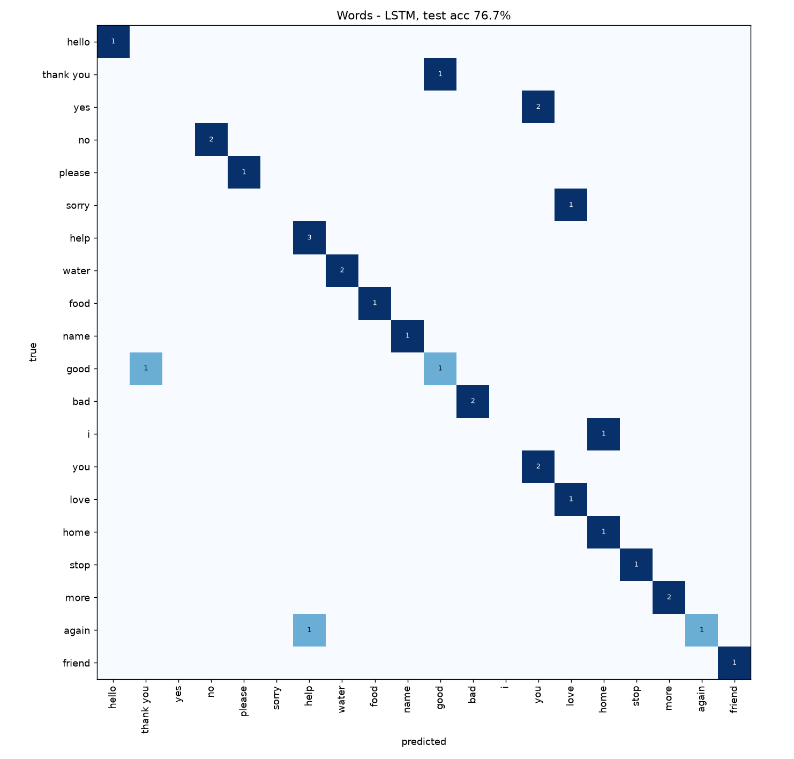
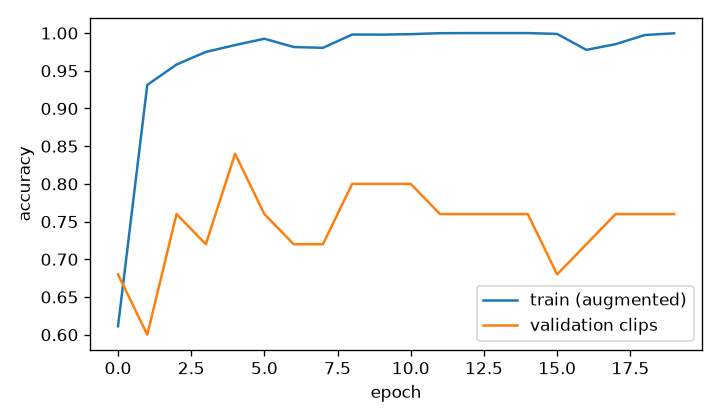

# Dynamic word classifier (LSTM)

WLASL clips: 158 for 20 words (4-14 per word, 37 signers). Per-word, signer-disjoint split train 103 / val 25 / test 30 clips (test clips with the same signer+word in train: 0); each training clip gives 61 samples (time-warp crops, rotation, aspect, mirror, position shift, jitter).

Model: Masking -> LSTM(96) -> LSTM(64) -> Dense(64) -> softmax over 30 frames x 134 features.

| metric | value |
|---|---|
| validation accuracy | 84.0% |
| **test accuracy** | **76.7%** |
| test top-3 accuracy | 96.7% |
| chance level | 5.0% |

With one or two test clips per word these numbers are noisy (each clip is 3.3% of the test set).

Clips per word: hello 4, thank you 7, yes 12, no 11, please 7, sorry 7, help 14, water 9, food 7, name 6, good 10, bad 10, i 4, you 8, love 7, home 7, stop 5, more 8, again 8, friend 7





```
              precision    recall  f1-score   support

       hello      1.000     1.000     1.000         1
   thank you      0.000     0.000     0.000         1
         yes      0.000     0.000     0.000         2
          no      1.000     1.000     1.000         2
      please      1.000     1.000     1.000         1
       sorry      0.000     0.000     0.000         1
        help      0.750     1.000     0.857         3
       water      1.000     1.000     1.000         2
        food      1.000     1.000     1.000         1
        name      1.000     1.000     1.000         1
        good      0.500     0.500     0.500         2
         bad      1.000     1.000     1.000         2
           i      0.000     0.000     0.000         1
         you      0.500     1.000     0.667         2
        love      0.500     1.000     0.667         1
        home      0.500     1.000     0.667         1
        stop      1.000     1.000     1.000         1
        more      1.000     1.000     1.000         2
       again      1.000     0.500     0.667         2
      friend      1.000     1.000     1.000         1

    accuracy                          0.767        30
   macro avg      0.688     0.750     0.701        30
weighted avg      0.708     0.767     0.719        30

```

Shipped model (retrained on train + val clips): test accuracy 83.3%.
