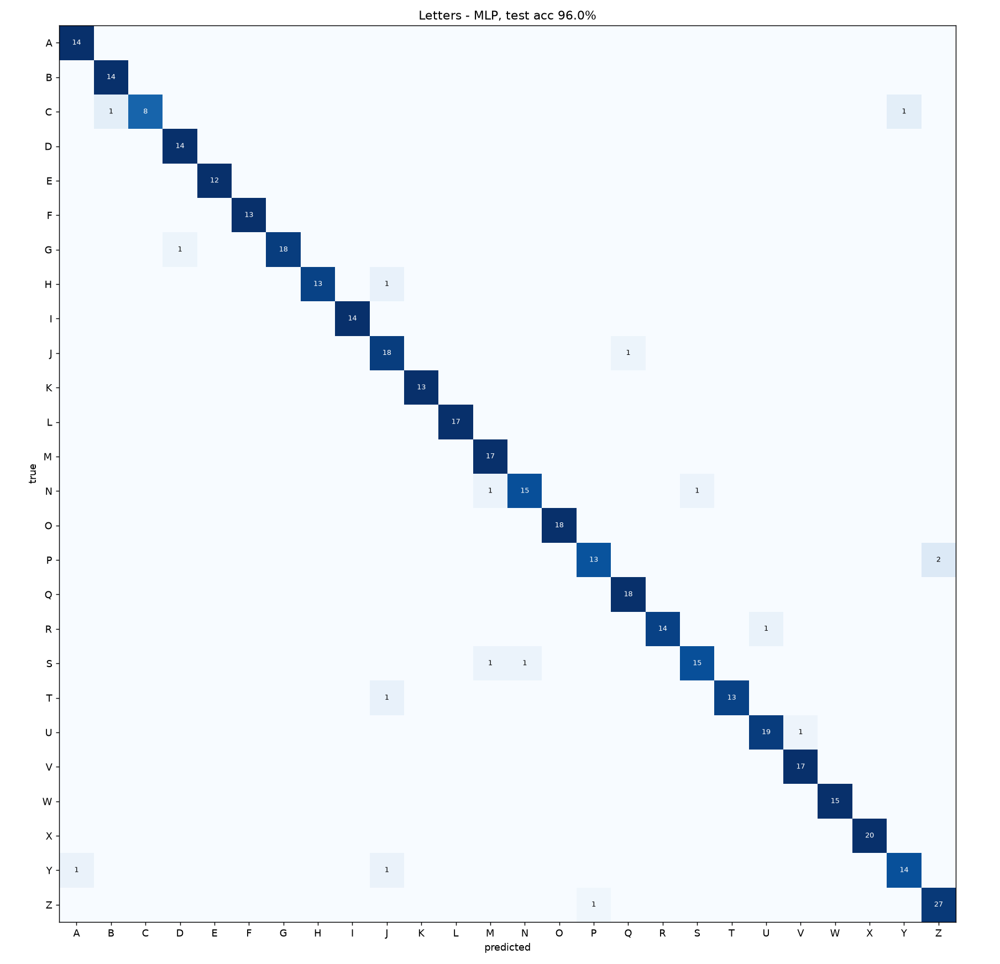

# Static letter classifier

Samples: 2796 (asl_letters: 674, asl_now: 2122), 26 classes. Stratified split train 1957 / val 419 / test 420; training set augmented x5 (rotation, aspect, mirror, jitter).

| model | validation accuracy |
|---|---|
| MLP | 95.5% |
| RandomForest | 92.6% |

**Selected: MLP - test accuracy 96.0%**

Test accuracy per source: asl_letters 93.4%, asl_now 96.8%

Most frequent confusions (true -> predicted): P->Z (2), Z->P (1), Y->J (1), Y->A (1), U->V (1), T->J (1), S->N (1), S->M (1)



```
              precision    recall  f1-score   support

           A      0.933     1.000     0.966        14
           B      0.933     1.000     0.966        14
           C      1.000     0.800     0.889        10
           D      0.933     1.000     0.966        14
           E      1.000     1.000     1.000        12
           F      1.000     1.000     1.000        13
           G      1.000     0.947     0.973        19
           H      1.000     0.929     0.963        14
           I      1.000     1.000     1.000        14
           J      0.857     0.947     0.900        19
           K      1.000     1.000     1.000        13
           L      1.000     1.000     1.000        17
           M      0.895     1.000     0.944        17
           N      0.938     0.882     0.909        17
           O      1.000     1.000     1.000        18
           P      0.929     0.867     0.897        15
           Q      0.947     1.000     0.973        18
           R      1.000     0.933     0.966        15
           S      0.938     0.882     0.909        17
           T      1.000     0.929     0.963        14
           U      0.950     0.950     0.950        20
           V      0.944     1.000     0.971        17
           W      1.000     1.000     1.000        15
           X      1.000     1.000     1.000        20
           Y      0.933     0.875     0.903        16
           Z      0.931     0.964     0.947        28

    accuracy                          0.960       420
   macro avg      0.964     0.958     0.960       420
weighted avg      0.961     0.960     0.959       420

```
